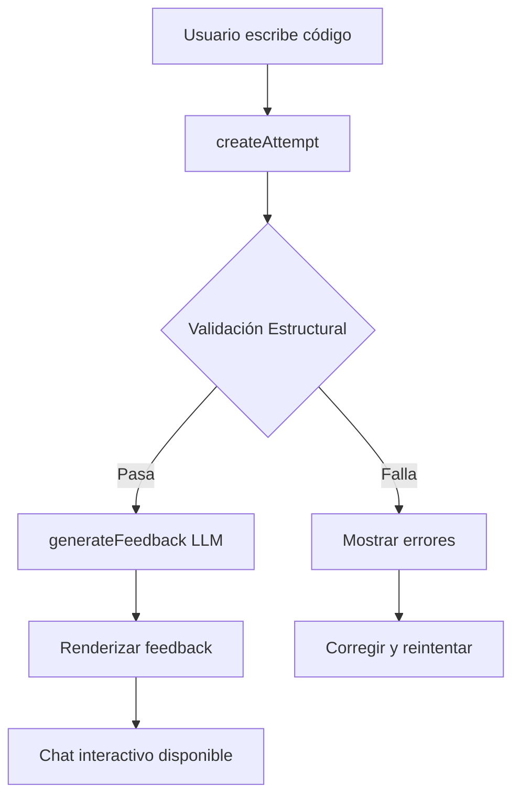

# Guía de Arquitectura para Nuevos Desarrolladores

## 📋 Índice

1. [Visión General](#visión-general)
2. [Stack Tecnológico](#stack-tecnológico)
3. [Arquitectura del Sistema](#arquitectura-del-sistema)
4. [Componentes Críticos](#componentes-críticos)
5. [Flujos Principales](#flujos-principales)
6. [Convenciones y Mejores Prácticas](#convenciones-y-mejores-prácticas)

---

## 🎯 Visión General

Esta es una **plataforma educativa para aprendizaje de DevOps** con evaluación automática impulsada por IA. Los estudiantes resuelven ejercicios (comandos Docker, Dockerfiles, compose files, conceptuales) y reciben feedback inteligente generado por modelos de lenguaje (LLMs).

### Características Principales

- ✅ **Ejercicios interactivos** con editor de código Monaco
- 🤖 **Feedback automático** con IA (Claude/GPT)
- 💬 **Chat inteligente** para aclaraciones y guía
- 🔍 **Validación estructural** de comandos y sintaxis
- 📊 **Panel de administración** para gestión de contenido
- 📈 **Tracking de progreso** por estudiante

---

## 🛠️ Stack Tecnológico

### Frontend

- **Framework**: Next.js 15 (App Router, React 19, Turbopack)
- **Lenguaje**: TypeScript 5
- **Estado Global**: Zustand (stores ligeros y performantes)
- **Data Fetching**: TanStack Query (React Query v5)
- **Estilos**: Tailwind CSS 4 + SCSS modules
- **UI Components**: Radix UI + shadcn/ui
- **Editor de Código**: Monaco Editor (VS Code engine)
- **Markdown**: react-markdown + rehype-sanitize + remark-gfm
- **Validación**: Zod schemas

### Backend (Referencia)

- **Framework**: FastAPI (Python)
- **Base de Datos**: PostgreSQL (vía Supabase)
- **Autenticación**: JWT en cookies HTTP-only
- **LLM**: Claude/GPT via API
- **Validación**: Python validators (Docker syntax, YAML, shell)

---

## 🏗️ Arquitectura del Sistema

### Estructura de Carpetas

```
src/
├── app/                    # Next.js App Router (páginas y rutas)
│   ├── admin/              # Panel de administración
│   ├── api/auth/           # API routes para autenticación
│   ├── ejercicios/         # Páginas de ejercicios estudiantes
│   ├── guias/              # Páginas de guías y contenido
│   └── progreso/           # Dashboard de progreso
├── components/             # Componentes compartidos UI
│   ├── badges/             # Badges de tipo y dificultad
│   ├── tiptap-**/          # Editor TipTap para admin (Markdown WYSIWYG)
│   └── safe-html.tsx       # Componente de sanitización HTML
├── features/               # Features por dominio (Clean Architecture)
│   ├── attempts/           # Sistema de intentos y feedback
│   ├── auth/               # Autenticación y sesión
│   ├── exercises/          # Gestión de ejercicios
│   ├── guides/             # Guías educativas
│   ├── llm/                # Status del servicio LLM
│   ├── metrics/            # Métricas y analytics
│   └── progress/           # Progreso de estudiantes
├── shared/                 # Código compartido transversal
│   ├── api/                # HTTP client y schemas Zod
│   ├── stores/             # Zustand stores globales
│   ├── ui/                 # Componentes UI base (shadcn)
│   └── utils/              # Utilidades generales
└── types/                  # Definiciones TypeScript globales
```

### Principios de Arquitectura

1. **Features por Dominio**: Cada feature (`attempts/`, `exercises/`, etc.) encapsula:
   - `api/`: Funciones de fetch al backend
   - `components/`: Componentes específicos del feature
   - `hooks/`: Hooks de React Query y lógica del feature

2. **Separación Cliente/Servidor**: 
   - `'use client'` explícito en componentes interactivos
   - Server Components por defecto para SSR
   - API routes en `/app/api/` para endpoints Next.js

3. **Type-Safety Total**:
   - Schemas Zod en `shared/api/schemas.ts`
   - Validación automática en `apiFetch()`
   - Inferencia de tipos con `z.infer<typeof Schema>`

---

## 🔑 Componentes Críticos

### 1. HTTP Client (`shared/api/http-client.ts`)

**Propósito**: Cliente HTTP centralizado con autenticación automática.

**Features**:
- ✅ Lee token JWT desde cookies (SSR y CSR)
- ✅ Inyecta header `Authorization: Bearer <token>`
- ✅ Valida respuestas con Zod schemas
- ✅ Manejo robusto de errores con `ApiError`
- ✅ Modo `swallowErrors` para diagnósticos

**Ejemplo de uso**:
```typescript
// Con validación Zod
const user = await apiFetch('/users/me', { schema: UserSchema });
// user es type-safe: User

// Sin romper el flujo
const result = await apiFetch('/endpoint', { swallowErrors: true });
if (result.__apiError) {
  console.log('Falló con status:', result.status);
}
```

**Flujo de autenticación**:
1. Usuario hace login → backend retorna cookie `auth_token`
2. `apiFetch()` detecta cookie automáticamente
3. Inyecta token en cada request
4. Si 401/403: `useUser()` limpia sesión

---

### 2. Sistema de Attempts (`features/attempts/`)

**Propósito**: Gestión de intentos de resolución de ejercicios.

**Flujo completo**:



**Archivos clave**:
- `api/attempts-api.ts`: Funciones de fetch
  - `createAttempt()`: Envía intento y valida estructura
  - `generateAttemptFeedback()`: Genera feedback con LLM
  - `sendChatMessage()`: Chat interactivo con IA
  - `fetchFeedbackHistory()`: Historial completo

**Validación estructural**:
- **command**: Valida sintaxis de comandos Docker/shell
- **dockerfile**: Valida estructura Dockerfile (FROM, COPY, etc.)
- **compose**: Valida sintaxis YAML y servicios
- **conceptual**: Sin validación estructural

**Estados del attempt**:
```typescript
interface Attempt {
  id: string;
  submitted_answer: string;              // Código enviado
  structural_validation_passed: boolean | null;
  structural_validation_errors: string[] | null;
  llm_feedback: string | null;          // Markdown generado por IA
  completed: boolean;                    // Marca ejercicio como completado
}
```

---

### 3. Exercise Runtime Store (`shared/stores/exercise-runtime-store.ts`)

**Propósito**: Gestiona el estado durante la resolución de un ejercicio.

**Estados principales**:
```typescript
{
  exerciseId: string | null;           // Ejercicio activo
  attemptId: string | null;            // Último attempt creado
  isSubmitting: boolean;               // Flag de carga (envío)
  isGeneratingFeedback: boolean;       // Flag de carga (LLM)
  structuralValidation: {
    status: 'idle' | 'passed' | 'failed';
    message?: string;
    errors: string[];                  // Errores bloqueantes
  };
  attemptSnapshot: Attempt | null;     // Snapshot para UI optimista
}
```

**Flujo típico**:
1. Montar componente → `setExercise(id)`
2. Enviar código → `setSubmitting(true)` + `createAttempt()`
3. Validar → `markValidationPassed()` o `markValidationFailed()`
4. Generar feedback → `setGenerating(true)` + `generateFeedback()`
5. Desmontar → `reset()`

**Regla de negocio**:
- Si `structuralValidation.status === 'failed'` → NO se genera feedback LLM
- Excepto ejercicios `conceptual` (sin validación estructural)

---

### 4. Session Store + useUser Hook

**Propósito**: Autenticación y gestión de sesión del usuario.

**Arquitectura**:
```typescript
// Store Zustand (global)
useSessionStore: {
  user: User | null;
  loggedOut: boolean;
  setSession: (user) => void;
  logOut: () => void;
}

// Hook React Query (data fetching)
useUser: {
  user: User | null;              // Sincronizado con store
  isAuthenticated: boolean;
  isAdmin: boolean;
  logout: () => Promise<void>;    // Limpia todo y redirige
}
```

**Flujo de autenticación**:
1. Login → Backend retorna cookie `auth_token`
2. `useUser()` detecta cookie y fetch `/users/me`
3. Respuesta exitosa → `setSession(user)`
4. Refetch automático cada 2 minutos (staleTime)
5. Si 401/403 → `clear()` y redirigir a login

**Logout**:
```typescript
const { logout } = useUser();
await logout(); // Limpia cookie, store, cache, y redirige SPA-style
```

---

### 5. Componentes de Ejercicios

#### `ExerciseWorkArea` (Vista principal)

**Responsabilidades**:
- Renderiza enunciado (HTML sanitizado)
- Formulario de envío (`AttemptSubmissionForm`)
- Panel de validación (`StructuralValidationPanel`)
- Chat de feedback (`FeedbackChat`)
- Historial de intentos

**Lógica de visibilidad**:
```typescript
const canShowFeedback = (() => {
  if (!lastAttempt) return false;
  if (exercise.type === 'conceptual') return true;
  // Para otros tipos, requiere validación passed
  return validation.status === 'passed';
})();
```

#### `AttemptSubmissionForm`

**Features**:
- Editor Monaco con syntax highlighting
- Modal de confirmación si ya hay feedback
- Integración con `exercise-runtime-store`
- Auto-submit + auto-feedback (si enabled)

**Lenguajes Monaco**:
- `dockerfile` → Syntax Dockerfile
- `shell` → Comandos Docker/Bash
- `yaml` → Docker Compose
- `markdown` → Respuestas conceptuales (textarea)

#### `FeedbackChat`

**Features**:
- Burbujas user/assistant/system
- Markdown con `react-markdown` + sanitización
- Chat bidireccional con contexto completo
- Scroll automático al agregar mensajes

**Estados de burbuja**:
- **user**: Código/mensaje del estudiante (azul, derecha)
- **assistant**: Feedback LLM (gris, izquierda)
- **system**: Errores estructurales (amarillo, centrado)

---

## 🔄 Flujos Principales

### Flujo 1: Resolución de Ejercicio

```
1. Usuario navega a /ejercicios/[exerciseId]
   ↓
2. ExerciseWorkArea se monta
   ↓
3. useExerciseRuntimeStore.setExercise(id)
   ↓
4. Usuario escribe código en Monaco
   ↓
5. Click "Enviar intento"
   ↓
6. AttemptSubmissionForm.handleSubmit()
   ├─ runtime.setSubmitting(true)
   ├─ createAttempt({ exercise_id, submitted_answer })
   │  └─ Backend valida estructura
   ├─ Si validación falla:
   │  └─ runtime.markValidationFailed(errors)
   ├─ Si pasa y enable_llm_feedback:
   │  ├─ runtime.setGenerating(true)
   │  └─ generateAttemptFeedback()
   └─ runtime.setSubmitting(false)
   ↓
7. UI actualiza:
   ├─ StructuralValidationPanel muestra resultado
   ├─ FeedbackChat muestra feedback (si disponible)
   └─ AttemptsCompactList actualiza historial
   ↓
8. Usuario puede chatear con IA
   ├─ Escribe pregunta
   ├─ sendChatMessage({ exercise_id, attempt_id, message })
   └─ Respuesta se agrega al chat
```

### Flujo 2: Autenticación

```
1. Usuario visita /autenticacion/iniciar-sesion
   ↓
2. Ingresa credenciales y submit
   ↓
3. POST /api/auth/login
   ├─ Backend valida credenciales
   └─ Retorna cookie 'auth_token' (HTTP-only)
   ↓
4. Redirige a /ejercicios o /admin
   ↓
5. useUser() hook se ejecuta:
   ├─ Detecta cookie
   ├─ Fetch /users/me
   └─ setSession(user)
   ↓
6. Usuario autenticado → UI renderiza contenido
```

### Flujo 3: Generación de Feedback LLM

```
1. Attempt creado y validación passed
   ↓
2. generateAttemptFeedback({ exercise_id, submitted_answer })
   ↓
3. Backend construye prompt:
   ├─ Enunciado del ejercicio
   ├─ Solución esperada (si existe)
   ├─ Código enviado por estudiante
   └─ Instrucciones pedagógicas
   ↓
4. Envía a API de LLM (Claude/GPT)
   ↓
5. LLM retorna feedback en Markdown:
   ├─ "✅ Lo que está bien"
   ├─ "⚠️ Lo que puede mejorar"
   └─ "💡 Sugerencias (sin dar respuesta directa)"
   ↓
6. Backend guarda feedback en DB
   ↓
7. Frontend renderiza en FeedbackChat con react-markdown
```

---

## 📝 Convenciones y Mejores Prácticas

### Convenciones de Código

1. **Naming**:
   - Componentes: PascalCase (`ExerciseWorkArea`)
   - Hooks: camelCase con prefijo `use` (`useUser`, `useAttempts`)
   - Stores: camelCase con sufijo `Store` (`useSessionStore`)
   - Archivos: kebab-case (`exercise-work-area.tsx`)

2. **Imports**:
   - Alias `@/` para rutas absolutas desde `src/`
   - Agrupar imports: React → externos → internos → tipos
   - Usar import type para tipos TypeScript

3. **Estilos**:
   - Preferir Tailwind CSS sobre SCSS
   - SCSS solo para estilos complejos de TipTap/Monaco
   - Usar `cn()` utility para merge condicional de clases

4. **State Management**:
   - **Zustand**: Estado global simple (session, UI, runtime)
   - **React Query**: Data fetching y cache (API calls)
   - **useState**: Estado local de componentes

### Seguridad

1. **XSS Prevention**:
   - Usar `SafeHtml` componente para HTML user-generated
   - `rehype-sanitize` en todos los Markdown renders
   - Nunca `dangerouslySetInnerHTML` sin sanitizar

2. **Autenticación**:
   - Token JWT en cookies HTTP-only (no localStorage)
   - Validar token en cada request backend
   - Logout limpia cookies server-side

3. **Validación**:
   - Zod schemas en frontend Y backend
   - Nunca confiar en datos del cliente
   - Sanitizar inputs antes de guardar en DB

### Performance

1. **Code Splitting**:
   - `'use client'` solo en componentes interactivos
   - Lazy load componentes pesados (`Monaco`, `TipTap`)
   - Server Components por defecto

2. **Caching**:
   - React Query con staleTime apropiado
   - `revalidatePath()` en mutations server-side
   - Memoización con `useMemo`/`useCallback` solo si hay evidencia de problema

3. **Optimización de Imágenes**:
   - Usar `next/image` para optimización automática
   - Lazy loading de imágenes fuera del viewport

### Testing (Future)

```typescript
// Unit tests: Vitest
// Integration: Testing Library
// E2E: Playwright

// Ejemplo estructura:
src/features/attempts/__tests__/
├── attempts-api.test.ts          # Unit tests de API
├── use-attempts.test.tsx         # Hook tests
└── attempt-submission-form.test.tsx  # Component tests
```

---

## 🚀 Getting Started

### Requisitos

- Node.js 20.x (LTS)
- pnpm 9.x
- Acceso al backend (FastAPI en otro repo)
- Variables de entorno configuradas

### Setup Inicial

```bash
# Instalar dependencias
pnpm install

# Copiar .env.example a .env.local
cp .env.example .env.local

# Editar variables
# NEXT_PUBLIC_API_BASE_URL=http://localhost:8000

# Iniciar dev server
pnpm dev

# Abrir http://localhost:3000
```

### Scripts Disponibles

```bash
pnpm dev          # Dev server con Turbopack
pnpm build        # Build producción
pnpm start        # Servidor producción
pnpm lint         # ESLint check
pnpm lint:fix     # ESLint auto-fix + remover imports no usados
pnpm format       # Prettier format all
pnpm format:check # Prettier check
pnpm typecheck    # TypeScript check sin build
```

### Estructura de Commit

```
feat: agregar chat interactivo en FeedbackChat
fix: corregir validación de Dockerfile vacío
docs: actualizar arquitectura de attempts
refactor: simplificar lógica de useUser
style: aplicar prettier a todos los archivos
```

---

## 📚 Recursos Adicionales

### Documentación Técnica

- [FRONTEND_ARCHITECTURE.md](./FRONTEND_ARCHITECTURE.md) - Arquitectura detallada
- [BACKEND_ARCHITECTURE_FULL.md](./BACKEND_ARCHITECTURE_FULL.md) - Backend API
- [ENDPOINTS_README.md](./ENDPOINTS_README.md) - Documentación de endpoints

### Archivos Clave para Explorar

1. **HTTP Client**: `src/shared/api/http-client.ts`
2. **Attempts API**: `src/features/attempts/api/attempts-api.ts`
3. **useUser Hook**: `src/features/auth/hooks/use-user.ts`
4. **Exercise Runtime Store**: `src/shared/stores/exercise-runtime-store.ts`
5. **ExerciseWorkArea**: `src/features/exercises/components/student/exercise-work-area.tsx`
6. **Schemas Zod**: `src/shared/api/schemas.ts`

### Tips para Nuevos Desarrolladores

1. **Empieza por los schemas**: `shared/api/schemas.ts` te da el modelo de datos completo
2. **Sigue el flujo de un feature**: Abre `attempts/` y lee api → hooks → components
3. **Usa las DevTools**: React Query Devtools y Zustand devtools están habilitados
4. **Lee los JSDoc**: Todos los archivos críticos tienen documentación inline detallada
5. **Pregunta al equipo**: No dudes en abrir issues o PRs con dudas

---

## 🤝 Contribuir

### Workflow

1. Crear branch desde `main`: `git checkout -b feat/mi-feature`
2. Hacer cambios con commits atómicos
3. Asegurar que pasa lint y typecheck: `pnpm lint && pnpm typecheck`
4. Push y abrir PR con descripción clara
5. Code review por al menos 1 dev
6. Merge a `main` con squash

### Checklist de PR

- [ ] Código formateado con Prettier
- [ ] Sin errores de ESLint
- [ ] Sin errores de TypeScript
- [ ] Documentación JSDoc agregada (si es feature complejo)
- [ ] Tests agregados (cuando aplique)
- [ ] README actualizado (si cambió setup)

---

**¿Preguntas?** Abre un issue o contacta al equipo principal. ¡Bienvenido al proyecto! 🎉
